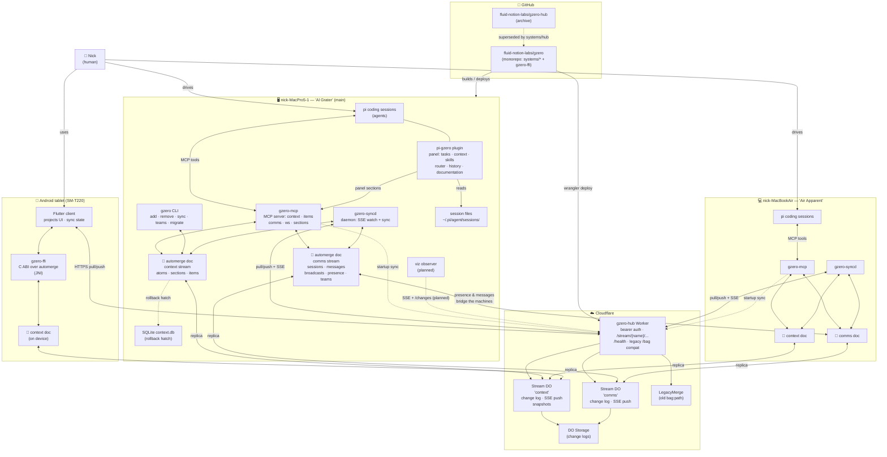

# Architecture — actors and entities

*2026-10-20. Who and what exists in the gzero system, and how they
connect. Every durable state flows through automerge docs replicated
via the hub's Stream DOs; nothing talks to hub storage directly. The
comms stream is the connective tissue between machines: presence,
messages, broadcasts, and teams.*

## Actor classes

- **The human** drives the agents and uses the clients.
- **pi coding sessions** are the agents: they act through the
  gzero-mcp tool surface and are seen in the plugin's panel sections.
- **Daemons and clients** (gzero-mcp, gzero-syncd, the CLI, the
  Flutter app) move state between local automerge docs and the hub.

## States

| Entity | Where | Notes |
|---|---|---|
| context stream doc | local + Stream DO | atoms, sections, work items |
| comms stream doc | local + Stream DO | sessions, messages, broadcasts, presence, teams |
| session files | `~/.pi/agent/sessions/` | local-only; presence rows are the global layer |
| legacy SQLite | rollback hatch | slated for removal once all machines cut over |
| hub change logs | DO Storage | per-stream, since-cursor reads + SSE push |

## Planned, not built

The **viz observer** (dashed): a small Node/TS process holding the
hub token, subscribing to each stream's SSE and serving JSON to a
browser — the first web version of the visualization. Spec:
`explorations/research/gzero-viz/README.md`.
