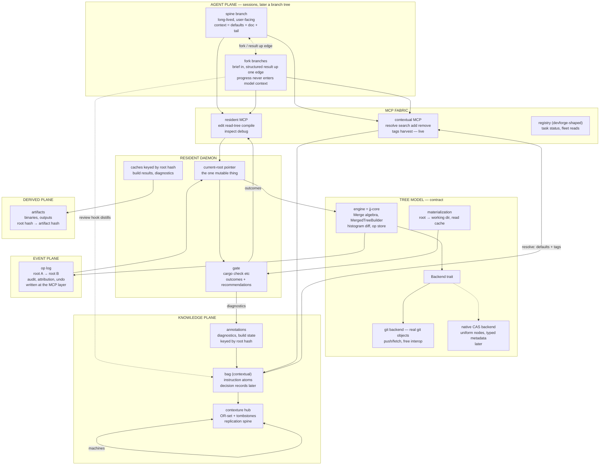

# Contexture — architecture

## Status

The umbrella architecture: the whole system, of which contextual (the
bag) is one subsystem — the Knowledge plane's live part. The bag-only
architecture it replaced lives on as the memory-plane doc:
`contextual/research/memory-plane.md` (through the `contextual`
symlink here; formerly this file). Everything here is grounded in
existing research; each section points at its source doc. The
ai-harness (branch/fork session tree) is *later* — included as named
moving parts with issues/considerations, not designed here.

3D diagram of the whole umbrella: [`architecture.glb`](architecture.glb)
(same directory; built with scene-mcp from the mermaid below).

## Naming

| term | meaning |
|---|---|
| contexture | the umbrella system this doc describes |
| contextual | memory subsystem: the bag of atoms (live), later decision records + trajectory |
| resident | daemon owning the canonical project tree tip: edits, gate, caches |
| tree model | the contract: op-based edits over immutable, content-addressed roots |
| engine | jj-core: `Merge<T>`, `MergedTree`, builders, diff, op store (`resident-mcp/jj-extraction.md`) |
| hub | **contexture** (the deployed Worker + DO; old name `contexture-hub`, URL unchanged): replication spine for bags, records, annotations |
| elastic | the eventual typed layer over automerge (record types, folds, policy) — extracted from contextual only when a second consumer appears (`plan2.md`) |
| gate | the edit gate: structured outcomes (`applied/partial/edits-needed/error`) + recommendations |
| devforge | process/service orchestrator + the task registry (`research/dev-lifecycle/`) |

ize is **shelved** (2026-10): kernel/FUSE capture has too many fs-model
problems and attribution ("which edit made the change") is unknowable
at the VFS layer. Capture moves to the MCP layer — the construction
point — where attribution is intrinsic.

## The five planes

All of contexture's data lives in one of five planes. Each plane has
its own identity discipline and replication story — that discipline is
the architecture; the moving parts just implement planes.

| plane | content | identity | replication | live |
|---|---|---|---|---|
| **Content** | project trees, code, files | content hash (Merkle root) | git transport now, native CAS later; Merkle sync (`resident-mcp/replication.md`) | design; engine vendored |
| **Knowledge** | instruction atoms, later decision records | atom text (identity = text, `lattice.md`) | OR-set + tombstones, lattice merge, hub | **live** (`nursery/contextual`) |
| **Events** | op log: roots A→B, agent writes — recorded at the MCP construction point | op id / root pair | append-only; folds into snapshots | partial (jj op log) |
| **Derived** | build artifacts, diagnostics, caches | `(input hash → output hash)`; never enters a tree | recomputable; cache, not truth (`tree-models` §8) | design |
| **Conversational** | session records, branch transcripts | session id + lineage edge | single-writer append-only per branch (`ai-harness-memory` §3.9) | later (pi files today) |

Orthogonality rules:

- Knowledge never enters content (annotations reference hashes; no
  metadata in the tree beyond the core struct).
- Derived never enters content (root hash subsumes inputs; same root ⇒
  same result — cache by root).
- Events are derived-able from content but recorded anyway (audit,
  attribution, undo).
- Conversational stays out of all others until review-hook distillation
  moves it into Knowledge (tagged, not defaults).

## High-level moving parts

Key flows:

1. **Edit loop (the main story):** agent `edit` op → daemon applies via
   engine (`MergedTreeBuilder`) → new root via backend → op-log entry
   (A→B) → gate runs against a materialized working dir (read cache) →
   structured outcome returns to the agent; diagnostics land as bag
   annotations keyed by root B. One round trip replaces
   edit → cargo check → parse stderr.
2. **Compile loop:** daemon asks for `(root B)` in the artifact cache —
   hit returns instantly; miss materializes, builds, stores, and the
   bag gets the annotation. Root hash is a complete input fingerprint.
3. **Memory loop:** resolve at branch start (frozen bytes, prefix
   stable), hashtags pulled on demand, review hook writes back curated
   atoms. Live today.
4. **Distribution:** git transport for content; hub for knowledge and
   annotations; both converge without coordination (Merkle identity /
  lattice merge).

## Detailed reference by part

### Resident daemon (`resident-mcp/architecture.md`)

- Owns: the current-root pointer (like a jj working-copy commit), the
  gate, caches, later the live instance (Smalltalk-style inspection).
- Does *not* own storage. Single writer by construction — the daemon is
  the leader, so ops get total order without consensus
  (`replication.md` §2).
- Build order: daemon skeleton + jj adapter → gate with `edits-needed`
  → batch ops + `partial` via jj conflict carry-through → native
  backend only when a capability gap is felt (metadata maps or hub
  distribution will be first).

### Tree model + engine (`resident-mcp/jj-extraction.md`)

- Contract: op-based edits; reads address `(root_hash, path)`;
  node core `{name, payload, children}`, metadata map as declared
  *capability* (`tree-models` §Recommendation).
- Engine = `jj-core` from crates.io — model machinery with no git, no
  FS: `merge.rs`, `merged_tree.rs`, `merged_tree_builder.rs` (the edit
  primitive), `diff.rs` (byte-level histogram, hunks), `op_store.rs`.
- FS machinery (snapshotting, fsmonitor, working copy) stays in `jj-lib`
  — bypassed for in-memory edits, used only for materialization and
  repo import.
- Conflicts are values (`Merge<Tree>`), materialized on demand → the
  `partial` gating state rides on existing jj machinery.

### Gate

- `applied | partial | edits-needed | error` + compiler recommendations
  as the *tool result*, not a scraped build log.
- Gate output observes; it must never affect the resulting root (keeps
  ops deterministic/replayable — the consensus upgrade path,
  `replication.md`).

### Bag + hub (`contextual/research/memory-plane.md`, `sync.md`, `lattice.md`)

- Live: instruction atoms, SQLite ledger, snapshot JSON as merge unit,
  hand-rolled OR-set/tombstone merge; hub deployed (Worker + DO).
- Also live in the same store: the kv annex (dotted keys → documents,
  `kv_*` MCP tools, local-first). Record types — kv-facts, decision
  records (`decision-memory-mcp`), annotations (diagnostics/build
  state keyed by root hash), work items (`plan2.md`) — converge on
  **elastic**: one event-sourced ledger + lattice merge (facts for
  immutable data, max-stamp registers for mutable fields,
  `datastore-survey.md`). One storage pattern, typed payloads. The
  workflow system's own content follows the same rule (plan2 §wsys
  rule): prose as kv documents, state as record types — markdown stays
  the authoring format, the bag is the store.
- The hub generalizes from "context hub" to **replication hub**: bags,
  decision records, annotations, later session records — one Worker+DO,
  more record types (`ai-harness-memory` §3.9).

### Events — capture at the MCP layer (ize shelved)

- The op log is written at the construction point: the resident is the
  sole writer, so every entry carries attribution intrinsically (MCP
  client, session, task). No spectator needed — which is also why
  retroactive redaction and post-hoc naming of op ranges remain simple
  curation operations on the log.
- ize's kernel-level capture is shelved: too many FS/FUSE-model
  problems, and "which edit made the change" has no answer at the VFS
  layer. Intent exists only where the edit is made — the MCP layer.

### devforge (`dev-lifecycle/`)

- Process/service supervision and the task registry the fork model
  needs (children post status; the model-context pipe stays empty;
  UIs read the registry). Complementary: resident owns code state,
  devforge owns processes. MCP over a local socket, one daemon —
  same architecture stance as resident.

## Ai-harness integration — later, with issues noted

The branch/fork session tree (`ai-harness-memory`) is a *consumer* of
contexture, arriving after the resident loop works. Its touch points
are already reserved: session records ride the hub; briefs come from a
composer role over the bag + digests; the registry is devforge. Issues
and considerations to hold:

1. **Prefix stability vs write-back.** Review-hook bag writes must not
   auto-refresh a running branch's injected context — refresh happens
   at branch boundaries or explicit reload, or every branch reprices
   its suffix (`ai-harness-memory` §3.7).
2. **Snapshot vs brief forks.** Snapshot forks (action-via-fork today)
   pay the parent's whole prefix; briefs must not silently become the
   transcript either. Hard budget on composed briefs; drop or
   interrogate on overflow.
3. **Who composes briefs** — parent model, harness, or contextual MCP
   (`compose_brief`)? Must be deterministic and cheap, run once per
   fork, then freeze. Open.
4. **Session records on the hub** are single-writer append-only per
   branch — strictly easier than the bag's multi-writer OR-set. No
   file-ness in the data model: ids and lineage only (pi session files
   are the bridge backend).
5. **Cache-LRU interaction:** interleaved fork traffic can evict the
   spine prefix; wide fan-out competes for cache residency. Mitigations
   unproven (same-model pools, short spine turns).
6. **Measurement gate:** build the usage ledger first; validate the
   spine+fork savings claim against traces before building the harness
   (workers-ai-billing method).
7. **Boundary discipline:** transcripts/artifacts are task state —
   out of the bag; only distillations enter (SKIP policy holds).
   Interrogation finds task facts in the tree; resolve finds durable
   facts in the bag.
8. **Known gaps carried:** `Item::ToolCall` lacks `tool_call_id` for
   use/result pairing; message-history request shape; loop executor.
9. **The gate meets forks:** a fork's edit ops run through resident
   too — gating outcomes become *per-branch* state, and parent
   absorption of a fork's edits is a root merge (conflicts first-class,
   jj-shaped). Not yet designed.

## Research map (what feeds this doc; what was pruned)

| dir | feeds |
|---|---|
| `context/` | bag, lattice, sync, hub, curation, pi-plugin, lockstep |
| `resident-mcp/` | daemon, gate, tree model, jj-core engine, replication families |
| `tree-models/` | node model, three-layer store, cross-cutting lessons |
| `ize/` | shelved 2026-10 (FUSE/attribution dead ends); its goals move to MCP-layer capture |
| `pijul-jj-backend/` | model analysis that selected jj-core (`source-analysis.md`) |
| `ai-harness-memory/`, `action-via-fork/`, `internal-harness/`, `cache-aware-compaction/` | session tree — later, §above |
| `decision-memory-mcp/` | decision records (record type 2) |
| `cloudrust/` | remote build sessions + artifact pull-back (CDC chunks → R2): the perf story, Derived plane execution |
| `dev-lifecycle/` | devforge: registry + supervision |
| `mcp-pipelining-scripting/` | MCP fabric composition (background) |

Pruned as irrelevant to this architecture: hardware dirs (`macpro*`,
`mini-itx-server`, `rpi-rtx-5060`, `sff-console-pc`), OS/desktop
(`gentric`, `driftwm`), UI/rendering (`gpui-distribution`,
`gpui-textured`, `visualization-survey`), `scene-mcp`, `voice-notes-app`,
`idea-collator` (consumer, not core), `cloudflare-containers`
(fork execution environments — matter only when §ai-harness lands;
cloudrust itself moved up, above),
`workers-ai-billing` (measurement method), `weeds`, `paintor`,
`navara-d22-valuation`, `remote-access`, `shared-launcher`,
`codex-cf-deepinfra`, `pi/`.

## Build order (re-phased 2026-10: workflow system first; resident further down)

The whole content-plane track — resident, tree model, gate — sits
**further down the track**. The next step is the **workflow system
(WS)**, built **locally first, distributed second** — the product
spec's ordering (`context-fresh-spec.md`). Local first also matches the
engine reality: a CRDT core only pays off once there is a second
replica, so nothing on the WS track needs the network yet.

1. **Now (live):** bag + hub + pi plugin + fork dispatch — memory plane
   shipping; the substrate for everything below.
2. **Next: workflow system (WS), local.** Project-workflow sections
   (vision, synopsis, architecture, plan, arbitrary checklists, user
   stories — any number of sections, typed), riding plan2's engine
   track: automerge behind `Storage` (L1 store done), record types
   (L2), work items + `cx item` + plan-task injection into context
   (L3), policy/ranking (L4). Single machine; no replication yet.
3. **Then: distribution.** Change-based push/pull (plan2 L1
   transport): the hub DO becomes an append-only log of automerge
   changes; item state rides the hub alongside atoms (plan2 L5). WS
   content syncs across machines the same way.
4. **Then: thin resident shim.** MCP tools (`edit`/`read-tree`/
   `compile`) → shim → **FS backend** (a working copy is the truth) with
   **jj-based history** (auto-snapshot per op batch; the working-copy
   commit is the tip; op-log attribution via shim-tagged op metadata:
   client/session/task). Gate = `cargo check` on the working copy;
   outcomes return structured. CF Artifacts as the remote mirror when
   needed. No in-memory trees yet.
5. **Then: remote build + artifact pull-back** — the perf story:
   shim's `compile`/gate dispatch to **cloudrust** (CF container, warm
   `target/` snapshot, fetch-at-build-not-teardown); binaries return as
   CDC chunk manifests — content-addressed chunks in R2, dedup across
   builds, chunk-DAG history. This *is* the Derived plane from day one:
   artifacts keyed by root hash, recompute-or-pull, never in the tree
   (`cloudrust/artifact-flow.md`).
6. **Then: in-memory tree.** Swap the shim's innards to the jj-core
   engine (`MergedTreeBuilder`); working copy demoted to a
   materialization cache; `partial` via conflict carry-through; batch
   ops; annotations schema; repo harvest (jj-native).
7. **Later (punted, after real thought):** full resident daemon — gate
   caches, live instance, native CAS backend when a capability gap is
   felt; ai-harness session tree on the hub; brief composer; devforge
   registry.

The sequencing discipline: the MCP surface stays identical across all
phases — the shim is swappable innards behind a stable tool contract.
Keeping it organized across this growth is a contexture job: the bag
holds the phase conventions, `architecture.md` holds the map.
