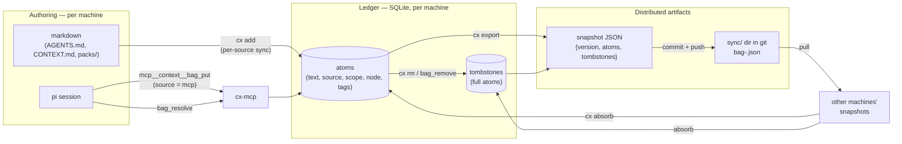
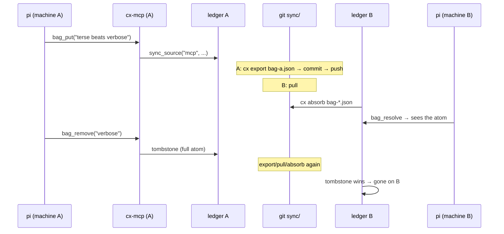

# Contextual — architecture

*The system: authoring → ledger → snapshots → merge → consumption.
Linked from `research/context/architecture.md` (symlinked there).
Companions: `research/context/lattice.md` (merge math), `sync.md`
(transport), `persistence.md` (durability), `distributed-chaos-plan.md`
(testing). Code: `nursery/contextual`, `nursery/bagflow`.*

## Naming (use it precisely)

| term       | meaning                                              |
|------------|------------------------------------------------------|
| contextual | the system                                           |
| context    | the resolved view an agent consumes (`cx`, `bag_resolve`) |
| bag        | the store: hashtable/multiset of atoms (internal noun) |
| atom       | one terse assertion: `{text, scope, node, tags}`; identity = text |
| ledger     | per-machine SQLite: rows `(text, source, scope, node, tags)` + tombstones |
| snapshot   | published merge unit: `{version, atoms, tombstones}` JSON |
| lattice    | CRDT merge semantics (see `lattice.md`)              |

## Components

| component     | crate     | role                                            |
|---------------|-----------|-------------------------------------------------|
| `cx`          | contextual| CLI: add/resolve/rm/tags/export/absorb          |
| `cx-mcp`      | contextual| MCP stdio server: bag_resolve/put/remove/tags for agents (pi) |
| `SqliteStore` | contextual| ledger backend behind the `Storage` trait       |
| snapshot JSON | (format)  | the contract — identical shape in both crates   |
| `bagflow`     | bagflow   | lattice engine prototype: DFIR dataflow, persistence, merge |
| `bagflow-serve`| bagflow  | HTTP wrapper over the engine (multi-machine test harness) |

Two pools, one bridge: **contextual** is the product (SQLite ledger, live
data); **bagflow** is the proven engine (in-memory lattice + JSON
snapshot). They share only the snapshot format. Unification is M4.

## Diagrams

### Components and artifacts



### Information flow — "mention here, appears there"



Properties carried by the format (not by the transport): merges are
commutative, associative, idempotent — arrival order and repetition are
irrelevant; a hub later would run the same `absorb`.

### Engines — now and M4

```mermaid
flowchart TB
    subgraph NOW["Now — two pools, one bridge"]
        direction LR
        C1["contextual\nSQLite ledger\n(product, live data)"] <..>|"snapshot JSON"| B1["bagflow\nlattice replicas\n(proven engine)"]
    end
    subgraph M4["M4 — one engine"]
        direction LR
        CX2["cx + cx-mcp"] --> ST["Storage trait"] --> EN["lattice engine\n(bagflow core)"] --> PS[("snapshot /\nor SQLite")]
    end
```

M4 decision (2025, revisitable): the unified engine crate will be named
**`contexture`**. SQLite stays for now — `Storage` is the plug point —
with a noted no-SQL endgame: one JSON snapshot per machine as the store,
`flock` + read-merge-write + atomic rename for same-machine races (the
lattice merge already handles cross-machine), so the lattice state is
the file is the wire format. Until then:

1. **Engine absorbs ledger**: contextual keeps its CLI/MCP and markdown
   sync, but the bag behind `Storage` becomes the bagflow lattice; SQLite
   becomes a projection. Strongest consistency story.
2. **Ledger stays, merge delegates**: keep SQLite as source of truth,
   route `absorb` through bagflow's `merge` so per-source replace becomes
   true lattice merge. Cheapest change.

## Invariants

- **Per-source sync**: a source (file, snapshot, `mcp`) owns its rows
  wholesale; re-importing replaces them. Idempotent.
- **Tombstones are full atoms** — exact identity needed to dominate a
  remote replica's add. Removal is addition; permanent.
- **Snapshot = durable artifact = merge unit** — one type serves
  persistence and distribution.
- **Resolve is a projection** — never mutates; untagged atoms are the
  default set, tags widen it.

## Failure modes

| failure            | behavior                                   |
|--------------------|--------------------------------------------|
| crash mid-write    | atomic tmp+rename; last good snapshot survives |
| duplicate absorb   | no-op (idempotence)                        |
| stale snapshot     | harmless (monotonic merge)                 |
| machine offline    | works locally; converges on return         |
| split brain        | none — replicas converge to the same union |

## Status

- ✅ ledger, CLI, MCP server (pi-connected), export/absorb, tombstones
- ✅ engine: lattice, persistence, HTTP replication demo
- ⬜ real-machine sync loop (`sync.sh`: pull → absorb → export → push)
- ⬜ chaos harness (compose + syncd, see `distributed-chaos-plan.md`)
- ⬜ M4 unification
