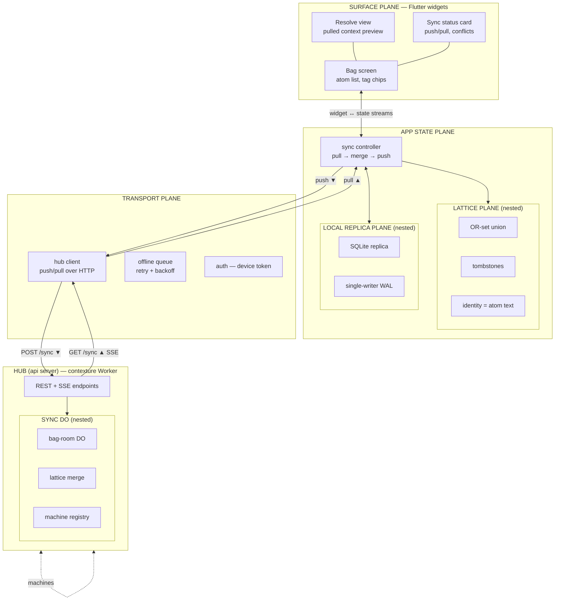

# Contexture — Flutter client (possible app)

Mobile client for testing the distributed layer first: the bag replica
on a phone, syncing through the hub. Speaks to the api server (the
contexture Worker + DO hub); no content plane, no resident — just
Knowledge-plane replication end to end.

3D diagram: [`flutter-client.glb`](flutter-client.glb) (built with
scene-mcp from the mermaid below). Planes are nested and stacked
vertically — Surface at the top, hub at the bottom; sync flows down,
pulls rise up.

## The plane stack

| plane | role | nested |
|---|---|---|
| **Surface** | Flutter widgets: bag screen (atom list, tag chips), resolve view (pulled context preview), sync status card (last push/pull, conflicts) | — |
| **App state** | bag store + sync controller (pull → merge → push loop) | **Lattice**, **Local replica** |
| **Lattice** (nested) | merge semantics: OR-set union with tombstones; identity = atom text | — |
| **Local replica** (nested) | device persistence: SQLite keyed by atom text, single-writer WAL | — |
| **Transport** | hub client (HTTP push/pull), offline queue (retry + backoff), device-token auth | — |
| **Hub (api server)** | contexture Worker: REST + SSE endpoints | **Sync DO** |
| **Sync DO** (nested) | Durable Object per bag: authoritative OR-set + tombstones, lattice merge point, machine registry | — |

## Why this shape

- **The phone is just another machine.** Same discipline as the pi
  plugin: local replica (SQLite) + lattice merge + hub sync. Nothing
  new to invent for the distributed test — the client is the smallest
  second consumer the elastic layer was waiting for.
- **Nested planes mirror the architecture.** Lattice (merge
  semantics) and Local replica (persistence) sit *inside* App state;
  Sync DO sits *inside* the hub — the same merge code conceptually on
  both ends, identity = atom text everywhere.
- **Vertical = the data path.** Widgets at the top, wire at the
  bottom. Push flows down through Transport to the hub; pulls and SSE
  events rise back up. The sync status card on Surface is the
  observable of the whole stack.
- **Offline-first.** The offline queue makes every mutation eventually
  push; conflict resolution is entirely lattice merge, so the app never
  blocks on the network.

## First distributed test (what "works" means)

1. Two machines (phone + dev box pi plugin) join the same bag via hub.
2. Add an atom offline on the phone → queue holds it → later push.
3. Same text added on both sides → one atom after merge (identity =
   text).
4. Remove on one side while the other edits → tombstone wins by
   lattice rules; no resurrection.
5. SSE: change on dev box appears on the phone without manual refresh.
