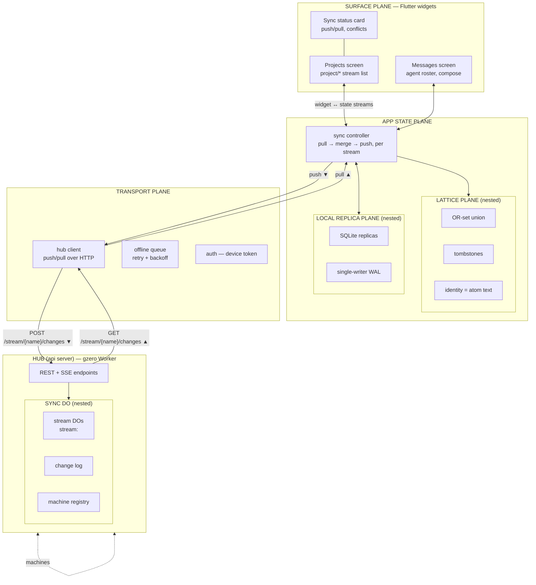

# Gzero — Flutter client (possible app)

Mobile client for testing the distributed layer first: device replicas
of the gzero streams, syncing through the hub. Speaks to the api server
(the gzero Worker + DO hub); no content plane, no resident — just
Knowledge-plane replication end to end.

3D diagram: [`flutter-client.glb`](flutter-client.glb) (built with
scene-mcp from the mermaid below). Planes are nested and stacked
vertically — Surface at the top, hub at the bottom; sync flows down,
pulls rise up.

*2026-10-19: terminology renamed with the streams work (item 7ace) —
"bag" is dead; the hub transports **streams** (named automerge change
logs). A stream named `project/<repo-scope>` **is** a project; two
system streams sit beside the projects: `context` (global knowledge
doc) and `comms` (chat + presence, its own thing). Surface scope also
expanded: the client's v0 screens are the **projects list** and
**messaging an agent** (decided with the user), not the atom bag
screen first drafted here.*

## The plane stack

| plane | role | nested |
|---|---|---|
| **Surface** | Flutter widgets: projects screen (stream `project/*` list), project view (sections + work items from that project's stream), messages screen (live agent roster from `comms` presence, compose + send), sync status card (last push/pull, conflicts) | — |
| **App state** | stream store + sync controller (pull → merge → push loop, one cursor per stream) | **Lattice**, **Local replica** |
| **Lattice** (nested) | merge semantics: OR-set union with tombstones; identity = atom text (project items: LWW fields + OR-set labels, same rules the core uses) | — |
| **Local replica** (nested) | device persistence: SQLite per stream, single-writer WAL | — |
| **Transport** | hub client (`/stream/{name}/…` HTTP push/pull), offline queue (retry + backoff), device-token auth (`CX_TOKEN`) | — |
| **Hub (api server)** | gzero Worker: REST + SSE endpoints | **Sync DO** |
| **Sync DO** (nested) | Durable Object per stream (`stream:<name>`): authoritative change log, machine registry | — |

## Why this shape

- **The phone is just another machine.** Same discipline as the pi
  plugin: local replica (SQLite) + lattice merge + hub sync. Nothing
  new to invent for the distributed test — the client is the smallest
  second consumer the elastic layer was waiting for.
- **Nested planes mirror the architecture.** Lattice (merge
  semantics) and Local replica (persistence) sit *inside* App state;
  Sync DO sits *inside* the hub — the same merge code conceptually on
  both ends, identity = atom text everywhere.
- **Vertical = the data path.** Widgets at the top, wire at the
  bottom. Push flows down through Transport to the hub; pulls and SSE
  events rise back up. The sync status card on Surface is the
  observable of the whole stack.
- **Offline-first.** The offline queue makes every mutation eventually
  push; conflict resolution is entirely lattice merge, so the app never
  blocks on the network.

## v0 surface (2026-10-19 scope)

1. **Projects list.** The `project/*` streams. Open items:
   - Per-scope project streams don't sync yet (workflow docs ride
     Track D3); until then the list can come from the scopes visible
     in the `context` stream's workflow sections (`ws scopes` data) —
     or the hub grows a `GET /streams` registry endpoint (small: the
     DO already tracks machines per stream; a worker-level index is
     needed to list them).
   - Which requires deciding: does the core split workflow docs into
     per-scope automerge docs (one stream per project), or keep one
     doc with a scope field? Leaning: per-scope docs — that's what
     makes "stream = project" literal and keeps the phone from pulling
     every project to show one.
2. **Message an agent.** The `comms` stream, already cross-machine and
   built (see `comms.md`): the phone writes `{dest: <session id>,
   sender, text, created}` into the comms doc and pushes; the agent's
   sync loop (session start + best-effort after every write) delivers.
   The roster comes from the synced presence rows (`sessions` map:
   machine, scope, cwd, label, last_seen) filtered to live entries.
   v1 addressing stays `dest = session id` (member-id addressing is
   the deferred thin layer).
3. **Sync status card** — the observable of the whole stack.

## First distributed test (what "works" means)

1. Two machines (phone + dev box pi plugin) join the same stream via hub.
2. Add an atom offline on the phone → queue holds it → later push.
3. Same text added on both sides → one atom after merge (identity =
   text).
4. Remove on one side while the other edits → tombstone wins by
   lattice rules; no resurrection.
5. SSE: change on dev box appears on the phone without manual refresh.
6. Message sent from the phone to a live agent session on the dev box
   is delivered on the agent's next sync; read receipt propagates back.
