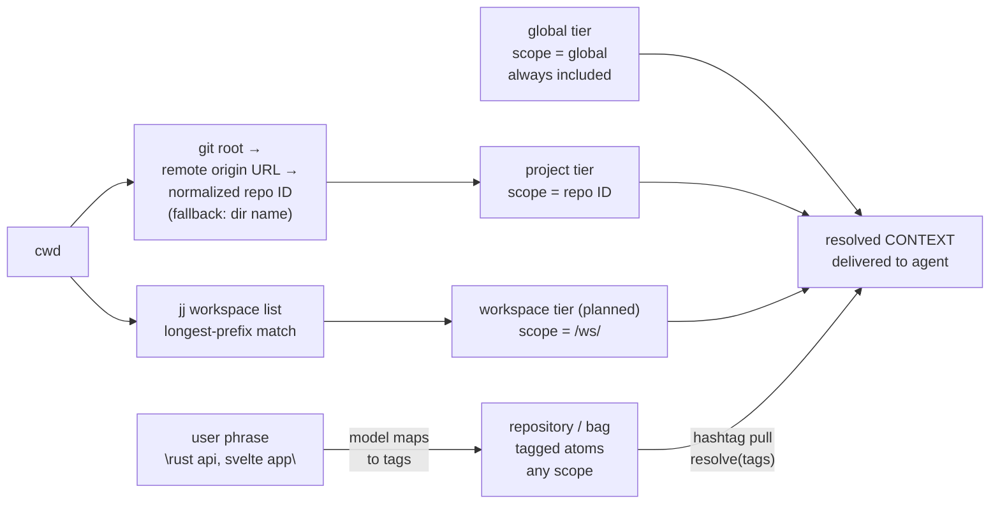
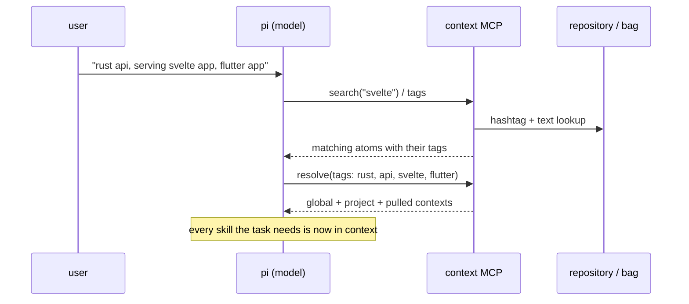
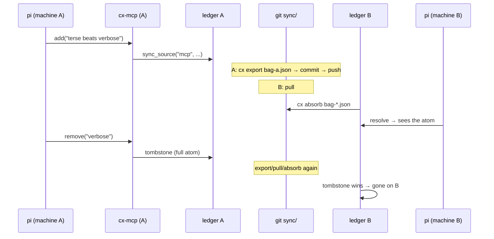

# Contextual — memory-plane architecture

*The Knowledge plane of contexture: authoring → ledger → snapshots →
merge → consumption. The whole-system architecture — planes, resident,
hub, tree model — is `research/context/architecture.md` (the
Contexture umbrella). Companions: `research/context/lattice.md`
(merge math), `sync.md` (transport), `distribution.md` (generalized
mechanism), `data-shape.md` (data register), `persistence.md`
(durability), `distributed-chaos-plan.md` (testing). Code:
`nursery/contextual`, `nursery/bagflow` (own repo,
`fluid-notion-labs/bagflow`; reference prototype, not renamed —
`plan2.md` §Engine packaging).

## Naming (use it precisely)

| term       | meaning                                              |
|------------|------------------------------------------------------|
| contextual | the bag system — the Knowledge plane of contexture |                                           |
| context    | what the agent receives: global ∪ project ∪ pulled-in |
| bag        | the repository of *possible* contexts; pulled via hashtag |
| atom       | one terse assertion: `{text, scope, node, tags}`; identity = text |
| ledger     | per-machine SQLite: rows `(text, source, scope, node, tags)` + tombstones |
| snapshot   | published merge unit: `{version, atoms, tombstones}` JSON |
| lattice    | CRDT merge semantics (see `lattice.md`)              |

## Components

| component     | crate     | role                                            |
|---------------|-----------|-------------------------------------------------|
| `cx`          | contextual| CLI: add/resolve/rm/tags/export/absorb/push/pull/harvest |
| `cx-mcp`      | contextual| MCP stdio server: resolve/search/add/remove/tags/harvest for agents (pi) |
| `SqliteStore` | contextual| ledger backend behind the `Storage` trait       |
| snapshot JSON | (format)  | the contract — identical shape in both crates   |
| `kv` annex    | contextual| dotted keys → documents, `kv_*` MCP tools (local-first) |
| automerge doc  | automerge-rs | state + history + sync core behind the `Storage` trait (L1); `elastic` = the deferred typed-layer crate |

One product, one core: **contextual** holds the CLI/MCP and the SQLite
ledger today; at plan2 milestone L1 the engine core is **automerge-rs**
behind the `Storage` trait, inside contextual — no separate engine
crate (`elastic` is the deferred name for the typed layer, if it is
ever extracted).

**Status (2026-10, updated):** `nursery/bagflow` is cloned (its own
repo, `fluid-notion-labs/bagflow`: DFIR dataflow, persistence,
cross-machine merge, HTTP serve wrapper). **contextual has no
dependency on it** (no hydroflow/dfir/lattices in its Cargo.toml; the
merge is hand-rolled in `absorb_snapshot`). Per `plan2.md` it stays an
unrenamed reference prototype: the engine core is **automerge-rs**
behind the `Storage` trait, inside contextual, and the typed record
layer starts as modules there too (`elastic` names the extraction, if
ever). `dfir_rs` stays optional (incremental views only). See
`lattice.md` and `distributed-state.md`.

## Resolution model — three tiers (+ workspace, planned)

Context is resolved automatically per session:

- **global tier** — user/author-level context, scope `global`, always in
- **project tier** — scope = **repo identity**, detected from cwd's git
  root: `git remote get-url origin`, normalized (strip scheme/`git@`,
  `.git` suffix, leading host) → e.g. `fluid-notion-labs/context`. Stable
  across machines and checkout paths; falls back to cwd basename when
  no git repo. The local project's standing context.
- **workspace tier (planned)** — scope =
  `<repo-id>/ws/<feat>`, detected from cwd via `jj workspace list`
  (longest-prefix match). Feature work always happens in a jj
  workspace at `.jj/workspaces/<feat>`; the tier carries that
  feature's working context, default-delivered while active.
- **repository tier** — the bag: tagged atoms in any scope;
  *pulled in* on demand via hashtag lookup (`resolve(tags)`), discovered
  via `search` when the model doesn't know the hashtag yet

Default delivery = untagged atoms of global + project scopes (and
the active workspace's, once that tier lands). Tags pull
from anywhere — that's the hashtag lookup.



### Repo identity is host-agnostic (pluggable backend)

The key is the **normalized repo URL**, not the hosting backend. Git
remotes now (GitHub, self-hosted, bare repos); later **Cloudflare
Artifacts** — git-compatible versioned storage with repos per project,
user, session, or task, plus Workers Builds auto-deploy. A repo's URL
changes host → context follows the repo, because scope keys on the
identity, not the path.

Planned Artifacts roles (not yet built):

1. **Project host** — repos live on Artifacts; `origin` URL normalizes
   to the same repo-ID scheme. Zero context-code change.
2. **Session repos** — Artifacts' per-session/branch model maps to the
   harness plan (agent sessions as branches off a baseline).
3. **Sync transport** — an Artifacts repo could host `sync/bag-<host>.json`
   as a git-protocol alternative to the hub; the hub (real-time events)
   remains the fast path.

### The pull-in workflow

The target interaction: the user names technologies or domains, and the
system brings all matching skills/contexts in — no manual curation.



Resolution rules:

| rule | behavior |
|------|----------|
| default | untagged atoms, scopes `global` + detected project |
| pull | `resolve(tags)` includes tagged atoms from any scope |
| discover | `search(text)` finds atoms when the hashtag is unknown |
| post | `add` writes to the detected repo identity (project scope) by default |

## Diagrams

### Components and artifacts

```mermaid
flowchart LR
    subgraph A["Authoring — per machine"]
        MD["markdown\n(AGENTS.md, CONTEXT.md)"
        PI["pi session"]
    end
    subgraph L["Ledger — SQLite, per machine"]
        DB[("atoms\n(text, source, scope, node, tags)")]
        T[("tombstones\n(full atoms)")]
    end
    subgraph D["Distributed artifacts"]
        S["snapshot JSON\n{version, atoms, tombstones}"]
        G["sync/ dir in git\nbag-<host>.json"]
    end
    MD -- "cx add\n(per-source sync)" --> DB
    PI -- "mcp__context__add\n(source = mcp)" --> MCP["cx-mcp"] --> DB
    PI -- "mcp__context__resolve" --> MCP
    DB -- "cx rm / mcp__context__remove" --> T
    DB -- "cx export" --> S
    T --> S
    S -- "commit + push" --> G
    G -- "pull" --> S2["other machines'\nsnapshots"]
    S2 -- "cx absorb" --> DB
    S2 -- "absorb" --> T
```

### Information flow — "mention here, appears there"



Properties carried by the format (not by the transport): merges are
commutative, associative, idempotent — arrival order and repetition are
irrelevant; a hub later would run the same `absorb`.

### Engines — now and L1

```mermaid
flowchart TB
    subgraph NOW["Now — two pools, one bridge"]
        direction LR
        C1["contextual\nSQLite ledger\n(product, live data)"] <..>|"snapshot JSON"| B1["automerge-rs\ndoc state + history\n(vendored crate)"]
    end
    subgraph L1["L1 — one engine"]
        direction LR
        CX2["cx + cx-mcp"] --> ST["Storage trait"] --> EN["automerge behind\nStorage: fold +\nchange application"] --> PS[("automerge doc /\nSQLite projection")]
    end
    end
```

Engine decision (plan2, milestone L1): the engine core is
**automerge-rs** behind the `Storage` trait, inside contextual — no
separate engine crate; `elastic` names the typed layer only if it is
ever extracted (the `contexture` name is reserved for the umbrella
system). SQLite stays for now — `Storage` is the plug point — with a
noted no-SQL endgame: one JSON snapshot per machine as the store,
`flock` + read-merge-write + atomic rename for same-machine races (the
lattice merge already handles cross-machine), so the lattice state is
the file is the wire format. Until then:

1. **Engine absorbs ledger**: contextual keeps its CLI/MCP and markdown
   sync, but the bag behind `Storage` becomes the automerge doc + fold;
   SQLite becomes a projection. Strongest consistency story.
2. **Ledger stays, merge delegates**: keep SQLite as source of truth,
   route `absorb` through automerge change application so per-source
   replace becomes true lattice merge. Cheapest change.

## Invariants

- **Per-source sync**: a source (file, snapshot, `mcp`) owns its rows
  wholesale; re-importing replaces them. Idempotent.
- **Tombstones are full atoms** — exact identity needed to dominate a
  remote replica's add. Removal is addition; permanent.
- **Snapshot = durable artifact = merge unit** — one type serves
  persistence and distribution.
- **Resolve is a projection** — never mutates; untagged atoms are the
  default set, tags widen it.

## Failure modes

| failure            | behavior                                   |
|--------------------|--------------------------------------------|
| crash mid-write    | atomic tmp+rename; last good snapshot survives |
| duplicate absorb   | no-op (idempotence)                        |
| stale snapshot     | harmless (monotonic merge)                 |
| machine offline    | works locally; converges on return         |
| split brain        | none — replicas converge to the same union |

## Status

- ✅ ledger, CLI, MCP server (pi-connected), export/absorb, tombstones
- ✅ hub: Cloudflare Worker in server mode (events in, snapshot out,
  `cx push` / `cx pull` / auto-post in `cx-mcp`) — multi-machine works
- ✅ engine: lattice, persistence, HTTP replication demo
- ✅ MCP tools renamed (`mcp__context__resolve/search/add/remove/tags`),
  tiered resolve with **repo-URL project identity** (git origin,
  normalized; dir-name fallback + legacy scope match), `search` tool;
  verified live: tiers resolve per cwd, `add` lands in
  `fluid-notion-labs/explorations`
- ✅ curation policy from hermes in the tool descriptions (`add` batch
  `operations`, self-healing `remove`; `curation.md`) — 5s cap on hub calls
- ✅ pi plugin P1+P2 (`pi-plugin.md`): per-turn `<context>` injection,
  install offer, `/context` commands, stale-binary check
- ✅ packs dissolved: atoms seeded, `packs/` + `recommend` deleted,
  project-relevance atoms in place, junk skills corpus removed via the
  new `cx rm-source` (`plan.md` M4); hub push of the new events pending
- ✅ pi plugin installed and verified live (injection + MCP tools in a
  real session)
- ✅ P4 migration: global `AGENTS.md` + explorations `CONTEXT.md` are
  pointer stubs — the bag is the sole authority, injected per session
- ✅ harvest: `cx harvest` + MCP `harvest` tool import AGENTS.md /
  CLAUDE.md / GEMINI.md / .cursorrules / .windsurfrules /
  copilot-instructions from any repo as project context (scope = repo
  identity, `*` bullets accepted, zero-bullet stubs protected) —
  contextual as the cross-agent context layer
- ⬜ Cloudflare Artifacts backend (planned — see "host-agnostic" above)
- ⬜ hub: live push (DO websockets) so pulls aren't per-session
- ⬜ chaos harness (compose + syncd, see `distributed-chaos-plan.md`)
- ⬜ L1 unification: automerge behind `Storage` — an `AutomergeStore`
  in contextual (`plan2.md` L1; the contexture name is reserved for
  the umbrella)
