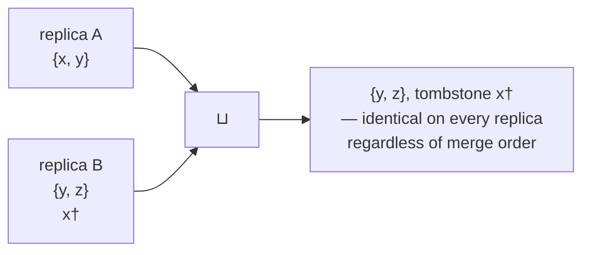

# The lattice — how the context bag converges

*Why the bag is a join-semilattice and what that buys. Code:
`nursery/elastic` (own crate, formerly bagflow). Companions:
`distributed-state.md` (why this approach over timely/differential),
`sync.md` (transport), `persistence.md` (snapshot as merge unit).*

## The idea in one paragraph

A **join-semilattice** is a set of states with a merge operation `⊔` that
is **commutative** (order-free), **associative** (grouping-free), and
**idempotent** (repeat-free), inducing a partial order (`a ≤ b` iff
`a ⊔ b = b`). Merge only ever moves state "up" — nothing is lost, nothing
rewinds. Convergence is then a theorem, not a protocol: if every replica
eventually receives every update and merges it, all replicas hold the
*identical* value. No coordinator, no vector clocks, no conflict
resolution — the conflict resolution *is* the type.

## The bag as a single lattice value

The entire bag is one value:

```rust
BagLattice = SetUnionWithTombsons<BTreeSet<Atom>, HashSet<Atom>>
```

A pair of grow-only sets, merged componentwise (product lattice). The
merge, from `lattices` 0.7:

```rust
fn merge(&mut self, other: SetUnionWithTombsons<SetOther, TombstoneSetOther>) -> bool {
    // Merge other set into self, don't include anything deleted
    // by the current tombstone set.
    self.set.extend(
        other.set.into_iter().filter(|x| !self.tombstones.contains(x)),
    );

    // Combine the tombstone sets. Also remove any items in the remote
    // tombstone set that currently exist in the local set.
    self.tombstones
        .extend(other.tombstones.into_iter().inspect(|x| {
            self.set.remove(x);
        }));
    // ...
}
```

Reading it:

- **Adds survive** — remote atoms union into the set.
- **Removes survive** — remote tombstones union into the tombstone set.
- **Removes beat concurrent adds** — the `inspect` evicts items the
  incoming tombstones kill, even if they were already local. A re-put of a
  tombstoned atom stays hidden (OR-set semantics).

That third rule is the deletion story. There are no timestamps, so
"last writer wins" is unavailable; instead, **removal is also an
addition** — a tombstone is an immutable fact that only ever accumulates.
Both the add and the delete are preserved forever, and the tombstone is
defined to dominate.



Merging the same states in the opposite order yields the same result —
that is the whole guarantee.

## The three properties, mapped to the sync flow

| property        | what it permits in practice                                      |
|-----------------|------------------------------------------------------------------|
| idempotent      | re-merging the same snapshot file is a no-op — no dedup bookkeeping |
| commutative     | per-machine snapshot files, merged in any pull order             |
| associative     | gossip / relaying / merge-of-merges is safe (chaos plan T6)      |

Each property deletes a whole category of distributed-system machinery:
idempotence deletes sequence numbers, commutativity deletes ordering
guarantees, associativity deletes topology constraints.

## Projection, not mutation

`resolve()` is not part of the lattice — it is a **derived view**: filter
untagged atoms (plus requested tags), sort canonically. Reads never mutate
state, so they can never conflict. This is also the dataflow payoff: the
resolved view is maintained *incrementally* by the DFIR graph
(`lattice_fold::<'static>` accumulates deltas), rather than recomputed per
read. `snapshot()` exports the full lattice value — which is exactly the
durable artifact and the cross-machine merge unit, one type for both.

## What the lattice does not give

- **Garbage collection.** Grow-only means tombstones are forever. Deleting
  is adding, so state only grows. Fine at context-bag scale (hundreds of
  atoms); revisit if it ever reaches millions.
- **Timeliness.** Convergence is eventual, by theorem — it says nothing
  about *when*. Transport latency dominates; see `sync.md`.
- **Ordering within an atom.** Identity is text; two machines asserting
  the same text with different tags merge their tag sets. Atoms are not
  individually versioned — there is no "atom v2", only more atoms.

## Pointers

- `nursery/elastic` (renaming from `nursery/bagflow`; repo
  `fluid-notion-labs/bagflow`, recovered after a disk loss) — the
  implementation (lib: dataflow + lattice; `persistence.rs`: snapshot;
  `bin/serve.rs`: HTTP). The DFIR wrapper is optional — the math above
  needs only the `lattices` crate (see `distributed-state.md`
  decisions 0–3). Renaming and record-type expansion per `plan2.md`
  (L0–L2).
- `research/context/sync.md` — the flow this lattice powers;
  `distribution.md` generalizes it beyond the bag.
- `research/context/data-shape.md` — the register of what rides it.
- `research/context/distributed-state.md` — the survey that picked
  DFIR + `lattices` over timely/differential.
- Time over the lattice: `history.md` (scrubbing), `lockstep.md`
  (jj work substrate), `deltadb.md` (Zed's adjacent substrate).
- Crates: `lattices` 0.7 (the math, from hydro-project),
  `dfir_rs` 0.16 (the dataflow runtime).
