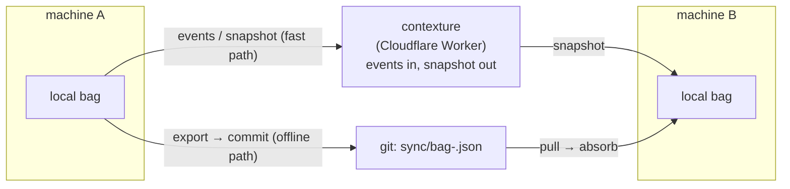

# Context bag — multi-machine sync flow

*The distributed store for all of contextual. Follows `persistence.md`;
engine: hand-rolled merge in contextual today, **elastic** (own crate,
formerly bagflow) as plan2 L1. Generalized successor — multi-datatype,
registers, blobs: `distribution.md`.*

## The store

- **One CRDT replica per machine.** Each machine holds a local bag
  (lattice state: atoms + tombstones) persisted as a versioned JSON
  snapshot document.
- **Per-machine snapshot files in git** — `sync/bag-<host>.json` in a
  shared repo. Machine A never writes machine B's file. The merged view is
  computed at read: fold every snapshot in the directory into one lattice.
  No shared mutable file, no locks, no clocks, no conflict.
- **Transport = git push/pull.** Later optionally a hub (Durable Object or
  D1) for push-style freshness; the merge code is identical.

## Transports

Same merge code behind both transports; the hub is the fast path, git is
the offline fallback.

## The flow ("mention here, appears there")

1. **Mention on machine A.** An atom is stated in a session, typed, or
   imported from markdown → `bag.put` (or `cx add`) → local lattice
   updated → snapshot persisted (atomic, per update).
2. **Publish.** A commits `sync/bag-a.json` and pushes. (A tiny wrapper
   can do commit+push after each session; or on demand.)
3. **Machine B pulls.** B's tooling merges every `sync/bag-*.json` into
   its local bag (`merge` is commutative/associative/idempotent — safe to
   re-apply, order-free, and safe to merge the same file twice).
4. **B sees it.** The atom is in B's resolved view: `cx` output, injected
   context, or the harness app's bag resources.
5. **Deletion propagates the same way.** A tombstones an atom → its
   snapshot carries the tombstone → B's merge hides it locally. Tombstones
   win over concurrent re-adds (OR-set).

## Hub: contexture (deployed)

Live at `contexture-hub.nick-hems.workers.dev` (deprecated worker name;
next deploy serves as `contexture.<subdomain>.workers.dev`): a Worker + Durable Object
running contexture in server mode. Clients **post events** (`PUT`/`remove`)
and **consume snapshots**; the hub merges and persists (debounced alarm).
`cx push` / `cx pull`; `cx-mcp` posts and pulls automatically when
`CX_HUB_URL` + `CX_TOKEN` are set. Git `sync/` remains the offline
fallback. Source: `nursery/contexture`.

## Testing the distributed flow

Simulated multi-client tests with chaos (partitions, slowness, crashes),
convergence oracles, and gossip topology are planned at
`nursery/contextual/research/distributed-chaos-plan.md` (symlinked here).

## Convergence of the two deletion models

For sync, tombstones are the published fact; cx's per-source rows stay the
per-machine authoring ledger. Concrete next step in `cx`:

- `cx export <file>` — write the machine's snapshot (alive atoms +
  tombstones) into the sync directory.
- `cx absorb <files...>` — merge every given snapshot into the local bag:
  new atoms become assertions (sourced as the snapshot file), removed
  atoms become local tombstones.
- `cx rm` gains tombstone recording, so a removal survives export and
  reaches other machines.

## What exists vs. what's next

- ✅ Engine: snapshot format (versioned JSON), `SnapshotStore` + `JsonFile`
  (atomic tmp+rename), persist-on-update, `merge` (commutative/associative/
  idempotent), `merge_snapshot` through the dataflow, tombstones survive
  restarts — all in the engine (elastic, formerly bagflow), tested.
- ✅ cx integration: `cx export` / `cx absorb` + tombstoning `rm`
  (full-atom tombstones; snapshot JSON shape is the cross-implementation
  contract). Distributed-workflow test plan: `nursery/contextual/research/`.
- ✅ Hub: built and deployed (see above) — fast path; `cx-mcp` pulls at
  startup and pushes on write. Git `sync/` remains the offline fallback.
- ⬜ Sync directory convention in a pushed repo + a small `sync.sh`
  (pull → absorb → export → commit → push).
- ⬜ Harness embedding (bag as MCP tools/resources in-process).
