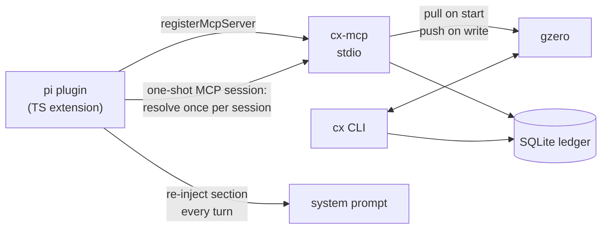

# Contextual — pi plugin spec

*The plugin: pi extension that connects the context system to pi sessions.
Code: `gzero-plugin/` (pi extension, blessed snapshot at
`~/.pi/agent/extensions/gzero`). Companions: the ws `architecture`
section (components, resolution model), `old/plan.md`, `old/sync.md`
(transport history). Supersedes M3's "decide the consumption path": the path is
**MCP**, and the split is below.*

## Division of responsibility

| component      | owns                                                        | talks to            |
|----------------|-------------------------------------------------------------|---------------------|
| `cx`           | authoring, export/absorb, push/pull                          | ledger (SQLite), hub|
| `cx-mcp`       | MCP server: resolve/search/add/remove/tags, startup pull, write push | ledger, hub |
| hub            | merged durable snapshot; event merge (OR-set, tombstones win)| clients             |
| **pi plugin**  | session glue: connect server, inject context, UI             | **cx-mcp only**     |

The plugin never reads SQLite and never calls the hub. It is a thin client
over the MCP surface. Everything that owns data lives in `gzero`.



## Installation

The plugin is glue; without the binaries it does nothing, so the first-run
experience is: detect → offer → install.

- **Detect.** On first session start, check `cx-mcp` (and `cx`) on PATH via
  a lookup, not a spawn.
- **Offer.** If missing, `ctx.ui.confirm`: "gzero is not installed —
  install it now? (provides cx and cx-mcp)".
- **Install.** On confirmation, run the install command in the background
  and notify on completion (never in the factory — it is long-running):

  ```sh
  cargo install --git https://github.com/fluid-notion-labs/gzero
  ```

  Note: plain `cargo install gzero` is wrong — the name is taken on
  crates.io by an unrelated utility crate. If the project later publishes,
  it needs a free crate name (e.g. `contextstream`); until then the `--git`
  form is the install path.
- **Decline / failure.** Plugin degrades to no injection (same path as
  server-connect failure); warn once, remind via `/context`.
- **Version check (later, P2+).** Compare plugin's expected tool surface
  against `tools/list`; a stale binary shows a "update gzero" hint.

## Plugin behaviors

### 1. Register the server

Factory registers the MCP server; pi connects it when the session starts
(allowed in the factory — no long-lived resources of our own are created):

```typescript
pi.registerMcpServer("context", {
  command: "cx-mcp",
  env: /* CX_DB, CX_HUB_URL, CX_TOKEN forwarded if set */ {},
});
```

Passing hub env through keeps offline mode automatic: unset vars → `cx-mcp`
skips hub traffic. A `context` entry in the user's `mcp.json` wins (documented
pi behavior) — that's the escape hatch for custom flags.

### 2. Inject default context

Resolve once per session (empty tags = global + project tiers only), cache
the text, and inject it as an additional prompt section **on every turn**.
Do not replace the system prompt: mutating `event.systemPromptOptions`
lets pi append a transcript delta and keeps its structured prompt
bookkeeping.

```typescript
pi.on("before_agent_start", async (event) => {
  if (resolvedBody === null) resolvedBody = await resolveViaOneShotMcp();
  if (resolvedBody !== null) {
    // fresh normalized options arrive every turn; the returned object
    // becomes this turn's system prompt — re-set or the section is dropped
    event.systemPromptOptions.sections["context"] =
      `<context>\n${PREAMBLE}\n\n${resolvedBody}\n</context>`;
  }
});
```

Details:

- **Every turn, not first prompt.** `before_agent_start` fires per prompt
  with a fresh normalized copy of the base options; the returned object
  becomes that turn's system prompt. A first-prompt-only injection has the
  section silently dropped from the prompt diff on turn 2 (found in P2).
- **One-shot MCP session.** Event handlers get plain `ExtensionContext` —
  no `executeTool` — so injection runs its own stdio session against
  `cx-mcp` (initialize → `tools/call resolve`). Same server, same protocol,
  no logic duplication; independent of whether pi's own MCP connection
  came up. ~40 ms per injection including process spawn.
- **Cache.** One resolve per session (the default tiers are stable session
  input); re-injected from cache each turn (no per-prompt spawn).
  `/context reload` re-fetches into the cache. Resolve failure → retry next
  turn; degrade silently (AGENTS.md fallback remains).
- **Format.** The tool's rendered output already groups by `# scope/node`
  with `- atom` bullets — inject verbatim. Empty resolve → inject nothing.
- **Tags are not injected.** Default tiers only; the model pulls tagged
  atoms itself via `resolve(tags)` when the user names technologies, and
  discovers hashtags via `search` — the pull-in workflow (ws
  `architecture` section) is unchanged and runs through the same MCP tools the
  model already sees (`mcp__context__*`).

### 3. Commands

| command           | action                                                             |
|-------------------|--------------------------------------------------------------------|
| `/context`        | re-run `resolve` and show the current context (tool result in chat)|
| `/context reload` | re-fetch and refresh the injected section for subsequent prompts   |
| `/context add`    | prompt for atom text + optional tags → `add` tool → confirm with `ctx.ui.confirm` |

Commands only orchestrate the existing MCP tools; they add no storage logic.

### 4. Pack recommendation — dissolved (decision 2026-10-10)

Packs (`packs/*.md` + `cx recommend`) were a file-based ingestion channel
from the pre-MCP design, parallel to the stream. Dissolved: tagged atoms are
just atoms; the pull-in workflow already covers them.

- Seed each pack file's atoms into the stream once (`cx add`), delete
  `packs/` + `recommend` from the code (work-list: `plan.md` M4).
- Project-relevance is data, not machinery: a project-scope atom names
  the tags that matter in that repo ("Rust project — `#rust` has
  build/workflow conventions"); the model pulls via `resolve(tags)`,
  discovers via `tags`/`search`.
- No plugin UX, no new MCP tools. Nothing to recommend — the model
  already has discovery.

## What the plugin deliberately does not do

- **Hub sync.** `cx-mcp` already pulls at startup and pushes on write. The
  plugin touching the hub would duplicate transport logic in a second
  language — the drift risk that killed the "reimplement in TS" option.
- **Tier/repo-identity logic.** `resolve_tiers` + `repo_identity` live in
  `gzero` (lib.rs). The plugin treats resolve as an opaque projection.
- **Tombstones, per-source sync, merging.** Ledger and snapshot semantics
  stay in the Rust crate; the plugin sees only alive atoms.
- **Double context.** Once injection works, AGENTS.md files shrink to a
  pointer (or disappear). Migration step: strip the context blocks from
  `~/.pi/agent/AGENTS.md` and repo `CONTEXT.md` after a verified session,
  keeping the import sources for `cx add` re-sync.

## Limitations

- **Mid-session pushes from other machines are invisible** until the next
  session (startup pull). Same as `cx-mcp` today. Fix belongs to the hub
  (live push via DO websockets — already on the architecture TODO); when it
  exists, the plugin can expose a `/context reload` that picks it up.
- **Event handlers cannot call tools**: `before_agent_start` gets plain
  `ExtensionContext` — no `executeTool` (that lives on
  `ExtensionToolContext`, tool execution only). Injection therefore runs a
  one-shot MCP stdio session against `cx-mcp` directly (initialize →
  `tools/call resolve`): still MCP, still no logic duplication. Verified
  in P1: ~40 ms per injection including process spawn. Gotcha found in the
  first live session: a stdout chunk can carry several lines (initialize +
  call replies coalesce) — the reader must drain the whole buffer per
  chunk, not take one line, or fast replies are discarded and the call
  times out.
- **Hub latency is capped**: `cx-mcp` pulls from the hub on startup, which
  sits on the injection critical path; hub calls now have a 5 s timeout so
  an unreachable hub degrades instead of stalling the first prompt.

## Trajectory — where this heads

The plugin manages AGENTS today, but gzero is headed for the
memory/harness role (see `../decision-memory-mcp/findings.md` for the
hermes/engram/memoryvault survey and the decision-record spec):

1. **Now:** context injection + pull-in workflow (this spec, P1–P2).
2. **Memory:** decision records (status, supersedes, rationale) as a second
   record type beside atoms — the `Storage` trait is the plug point, the
   MCP surface grows a sibling namespace. Hermes lessons apply as-is:
   bounded injection, curation over accumulation (`supersede` ↔ tombstones).
3. **Chat history:** sessions feed the store. pi session files now; the
   harness's typed transcript events (`ToolCall`, `FileEdit`, `TokenUsage`)
   later (see `../internal-harness/index.md`). The agent's own history
   becomes source material the curation loop distills into atoms —
   injection point unchanged, content grows.
4. **Harness:** the gpui fleet app reads context from and writes history
   to the same store; gzero becomes the memory layer across agents.

Design constraint this buys: the plugin stays a thin transport and the
injection point stays `before_agent_start` + MCP tools no matter what
record types or sources appear behind them.

Curation policy — how the agent is told to update the store — is a
separate spec: `curation.md` (distilled from hermes; feeds the `add` tool
descriptions and the injection preamble).

## Milestones

1. **P1 — wire-up (done).** Code in `gzero-plugin/`. Install detection + offer (background
   `cargo install --git`, notified on completion), `registerMcpServer`,
   first-prompt injection as a `<context>` section (with the curation
   preamble from `curation.md`), offline degradation. Verified: injection
   against the live ledger, degradation with no `cx-mcp`/no `cargo`/no UI,
   curation policy shipped in `cx-mcp` tool descriptions (`add` batch
   `operations`, self-healing `remove`) — see `curation.md` status.
2. **P2 — commands (done).** `/context` (scrollable overlay in TUI mode,
   notification elsewhere), `/context reload` (re-resolves into the cache;
   applies next turn), `/context add <text>` (optional tags input, confirm
   dialog, one-shot MCP add). Stale-install check via `tools/list` at
   session start warns when tools are missing.

**Injection correction found in P2:** `before_agent_start` fires on every
prompt with a *fresh* normalized copy of the base options, and the returned
options become that turn's system prompt. A first-prompt-only injection
would have the `context` section silently dropped from the prompt diff on
turn 2. The plugin therefore caches one resolve per session and re-sets
`sections["context"]` on every turn (cache refresh: `/context reload`).
3. **P3 — packs.** Dissolved by decision (§4 above) — no plugin work.
   Remaining code cleanup is in `plan.md` M4's work-list.
4. **P4 — migration (done).** `~/.pi/agent/AGENTS.md` and explorations
   `CONTEXT.md` are pointer stubs; the stream is the sole authority.
   Verified live: model sees layout/style/tooling atoms from injection
   alone. Stubs are bullet-free (an accidental `cx add` imports nothing)
   and warn that per-source sync would replace the atoms with the stub —
   the original file sources are never re-imported.
